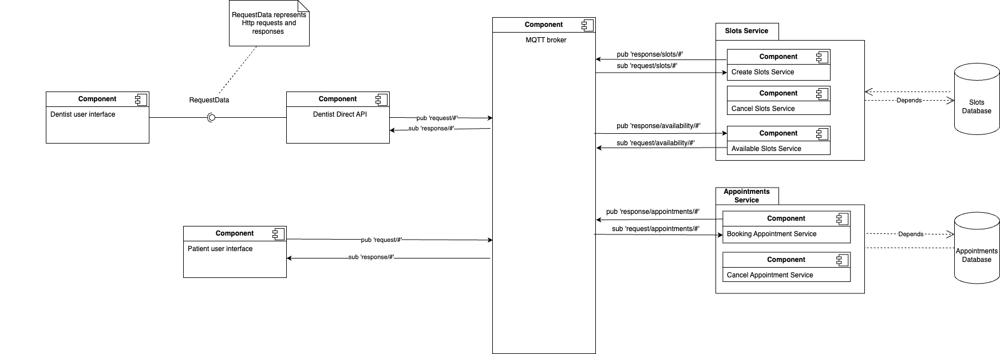

# Dentist Direct


Dentist Direct is a distributed system enabling residents and dentists of Gothenburg to book and manage dentist appointments conveniently. With a focus on flexibility and usability, the system is designed to handle dentist availability, cancellations, and user-friendly appointment management.

## Table of Contents
1. [Overview](#overview)
2. [Purpose and Benefit](#purpose-and-benefit)
3. [Features](#features)
4. [Dependencies and Requirements](#dependencies-and-requirements)
5. [How to Deploy](#how-to-deploy)
6. [Tech Stack](#tech-stack)
7. [System Design](#system-design)
    - [Software Diagram](#software-diagram)
8. [Setup and Get Started](#setup-and-get-started)
9. [Git Rules](#git-rules)
    - [Issues](#issues)
    - [Commits](#commits)
    - [Merge and Reviewing](#merge-and-reviewing)
10. [Contribute](#contribute)
11. [Acknowledgements](#acknowledgements)
12. [License](#license)

## Overview

Dentist Direct is a microservices-based system that simplifies the process of booking dentist appointments in Gothenburg. It features:
- A web interface for patients to browse and book appointments.
- An admin panel for dentists to manage their availability.
- MQTT middleware for efficient communication between services.

## Purpose and Benefit
Dentist Direct solves the problem of time-consuming manual searches for dentist appointments by:
 - Automating appointment scheduling.
 - Allowing dentists to manage their availability in a flexible way.
 - Providing real-time updates to users about slot changes.

## Features
Patients can view, filter, and book dentist appointments. Dentists can create, cancel, or update available slots. Patients or dentists can cancel appointments, with real-time updates across the system. The system uses MQTT middleware for fast and scalable message exchange between services.

## Dependencies and Requirements

**Dependencies**:
- **Node.js**
- **MongoDB**
- **Node MQTT.js**
- **Vue.js**
- **Express.js**
- **Bootstrap**

**Requirements**:
- A working MQTT broker (`mqtt://localhost:1883`)
- MongoDB running on `localhost:27017`
- Installed NPM package manager

## How to Deploy
Full deployment instructions will be added in future milestones.

## Tech Stack
- **Frontend:** Built with Vue.js and styled using Bootstrap for responsiveness, to achieve a user-friendly interface.
- **Backend**: Node.js with Express.js for API endpoints and business logic.
- **Database**: MongoDB for storing data.
- **Middleware**: Node MQTT broker for publish/subscribe messaging between services.

## System Design
#### Software Diagram
The diagram illustrates the system architecture, highlighting interactions between components:


## Setup and Get Started
- **Clone the Repository with SSH**
```sh
git clone git@git.chalmers.se:courses/dit355/2024/student_teams/dit356_2024_05/dentistdirect.git
cd dentistdirect
```
- **Install Dependencies**
```sh
npm install
```

## Git Rules
#### **Issues**
In this project, we use feature branches. Therefore, an issue must be created for all new features:
- The issue name must reflect the feature and be written as a noun.
- All issues need to be accompanied by a user story and acceptance criterias.
- All issues must be assigned to a team member
- The issue must be labeled with a priority level.
- The issue must be added to a milestone.

#### **Commits**
- Commit messages must be written in imperative form.  
```sh
#<Issue No.> <Commit message in imperative form (e.g. implement instead of implemented)>
```

#### **Merge and Reviewing**
- Merge conflicts should be solved locally.
- The code must be reviewed by another team member.
- The code must be tested before it is merged.
- The merge must me marked "approved" before the branch is merged to main.

## Contribute
We encourage you to contribute to DentistDirect! Please follow the guidelines in [CONTRIBUTING.md](CONTRIBUTING.md)  
for details on submitting pull requests, reporting issues, and proposing new features.

## Acknowledgements
**Team members**  
Rohma Wajid Rasul  
Fatemeh Akbarifar  
Fatma Ogoti Gichaba  
Karl Byland  
Anna Rebecca Skeppstedt

## License
This project is licensed under the MIT License. See [LICENSE.md](LICENSE.md) for more information.